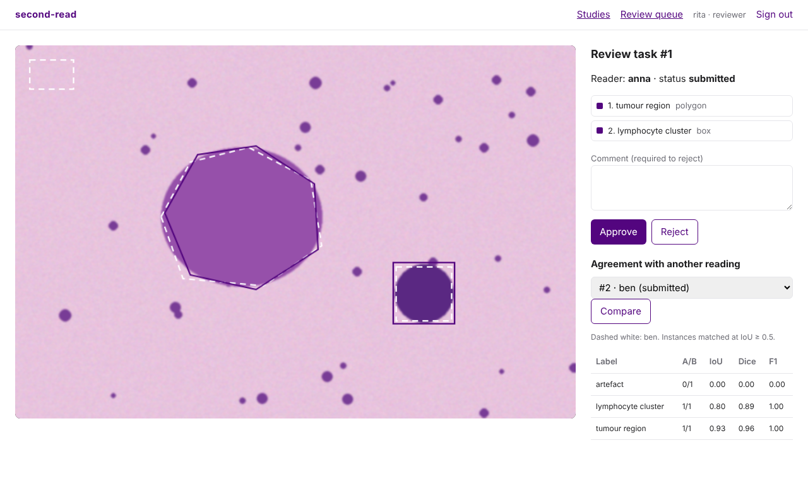
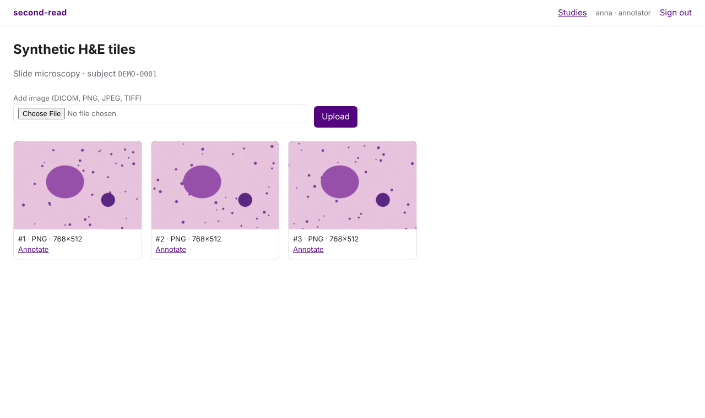
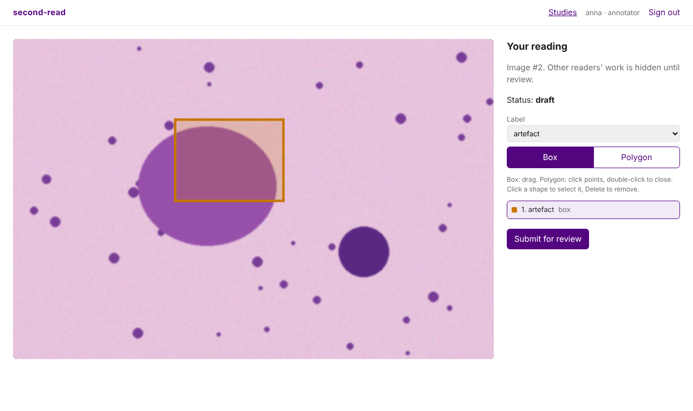
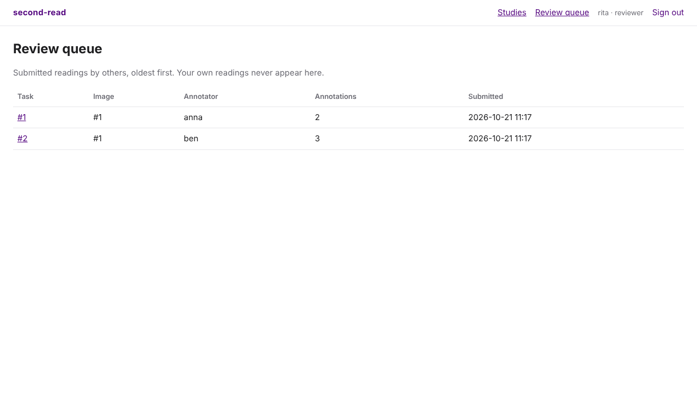

# second-read

A Django application for annotating medical images under a four-eyes review process.

Training data for medical imaging models comes from people outlining structures on images. Before an outline can be trusted it needs a second person to check it, a record of who changed what, and a measure of how much independent readers agree. This project implements that workflow end to end, with the rules enforced on the server rather than left to the user interface.



## What it does

- **Upload** DICOM, PNG, JPEG or TIFF. Every upload is converted to a de-identified PNG; the original file is not kept.
- **Annotate** with boxes and polygons against a fixed label set, in the browser or through the REST API.
- **Review** with a strict state machine: `draft → submitted → approved | rejected`, where a rejection needs a comment and sends the work back for correction.
- **Compare** two independent readings of the same image: pixel overlap (IoU, Dice) and object-level agreement (precision, recall, F1 after matching).
- **Export** approved annotations only, as COCO JSON with provenance per annotation.
- **Audit** every change in an append-only, hash-chained log that detects edits and deletions.

## Design decisions

**The rules live in one service layer.** `review/services/workflow.py` holds every state transition and permission check. The API, the admin and the demo seeder all go through it, so there is no second path that skips a rule or forgets to write the audit log. The admin shows tasks read-only for the same reason.

**Four eyes, without exceptions.** A reviewer cannot decide on a task they annotated. This holds for superusers too; a test covers it.

**Independent readings.** An annotator only ever sees their own task on an image. Another reader's work returns 404, not 403, so its existence is not revealed either. Only reviewers see all readings, and the agreement endpoint refuses to compare a reading that is still a draft.

**De-identification by whitelist.** DICOM headers carry names, IDs, birth dates and institution names. Instead of deleting a list of known identifying tags, which always misses one, the ingest copies out eleven technical attributes (modality, pixel spacing, window settings and similar) and throws the rest away with the original bytes. Files that declare burned-in annotation are refused, because identifying text inside the pixels cannot be removed by filtering headers. JPEG and PNG uploads are re-encoded, which drops EXIF data.

**Tamper-evident audit log.** Each event stores the SHA-256 of its own content plus the previous event's hash. The ORM refuses updates and deletes; if someone edits or deletes rows with raw SQL, `GET /api/audit/verify/` reports the first broken event and whether it was modified or removed. Audit writes happen in the same transaction as the change they describe, and the last event is row-locked so concurrent writers keep the chain linear.

**Two kinds of agreement.** Pixel overlap alone hides disagreements about how many objects there are: one reader outlines a region as one lesion, another splits it into three, and IoU is still 1.0. So agreement is reported per label at two levels: the union masks (IoU, Dice) and one-to-one instance matching at a configurable IoU threshold (precision, recall, F1). A label only one reader used counts as total disagreement, not missing data.

**Only approved work leaves the system.** The COCO export includes approved tasks only and records the annotator and task id on every annotation, so a training set can be traced back to who drew what and who approved it.

## Screens

| Study | Annotate | Review queue |
|---|---|---|
|  |  |  |

All images in the demo and the tests are generated. There is no patient data in this repository.

## Run it

```bash
python -m venv .venv && source .venv/bin/activate
pip install -r requirements-dev.txt
python manage.py migrate
python manage.py seed_demo      # users anna, ben (annotators), rita (reviewer); password second-read-demo
python manage.py runserver
```

Open http://localhost:8000, sign in as `rita` and open the review queue. Two readings of the first image are already submitted, so you can compare them straight away.

With Docker and PostgreSQL:

```bash
docker compose up --build
```

## API

Session or token authentication (`Authorization: Token ...`, tokens via the admin). All endpoints need the annotator or reviewer role.

| Method | Endpoint | Who | Purpose |
|---|---|---|---|
| GET, POST | `/api/studies/` | any role | List or create studies |
| GET, POST | `/api/studies/{id}/images/` | any role | List images, upload one (multipart `file`) |
| GET | `/api/studies/{id}/export/coco/` | reviewer | COCO JSON of approved annotations |
| GET, POST | `/api/images/{id}/tasks/` | any role | See visible readings, start your own |
| GET | `/api/images/{id}/agreement/?task_a=&task_b=&iou_threshold=0.5` | reviewer | Agreement between two submitted readings |
| GET, POST | `/api/tasks/{id}/annotations/` | owner | List or add annotations |
| PATCH, DELETE | `/api/annotations/{id}/` | owner | Change or remove one, while editable |
| POST | `/api/tasks/{id}/submit/` | owner | Send for review |
| POST | `/api/tasks/{id}/approve/`, `/reject/` | reviewer, not owner | Decide; `reject` needs `comment` |
| GET | `/api/audit/?object_type=&object_id=` | reviewer | Last 200 audit events |
| GET | `/api/audit/verify/` | reviewer | Check the whole hash chain |

Rule violations map to HTTP codes: 403 when you are not allowed, 409 when the task is in the wrong state, 400 for invalid geometry or uploads.

## Tests

```bash
pytest
```

54 tests, all passing locally on Python 3.12, Django 5.1 and SQLite. CI runs them on Python 3.12 against both SQLite and PostgreSQL 16, plus `ruff` and a check for missing migrations.

What they cover:

- Workflow: happy path with its exact audit trail, four eyes (including superusers), frozen submitted tasks, reject-fix-resubmit, no double decisions, before/after values in update events.
- Audit: chain verification, ORM refusal of changes, detection of raw SQL edits and deletions.
- Ingest: only whitelisted DICOM attributes survive (patient name, ID, birth date and institution checked against the stored metadata and pixels), windowing, MONOCHROME1 inversion, multi-frame, refused burned-in annotation, EXIF removal, garbage input.
- Agreement: known IoU and Dice values, one-to-one matching, count disagreement hidden by pixel overlap, labels used by one reader only.
- API: blinded readers, status codes per rule, upload deduplication, COCO export of approved work only.
- Pages: every screen renders for the right role and refuses the wrong one.

## Known limits

- **Whole-slide images are out of scope.** Gigapixel pathology slides need a tiled viewer (OpenSeadragon) and tiled storage. This project works on single images or tiles up to 100 megapixels.
- **One frame per DICOM.** Multi-frame files are reduced to the middle frame. A real radiology tool would let the reader scroll the series.
- **Compressed DICOM** (JPEG 2000, JPEG-LS) needs extra decoders such as `pylibjpeg` and is refused with a clear error until they are installed.
- **The audit chain is tamper-evident, not tamper-proof.** Someone with database access can rewrite the entire chain consistently. Anchoring the latest hash outside the database (a signed daily export, a write-once bucket) would close that gap.
- **No regulatory claim.** The audit trail and review rules follow ideas from GxP and 21 CFR Part 11 (attributable, contemporaneous, reviewed), but this is a portfolio project, not a validated system.

## Stack

Python, Django 5.1, Django REST Framework, pydicom, Pillow, NumPy, PostgreSQL or SQLite, pytest, plain JavaScript and canvas for the viewer (no build step).
