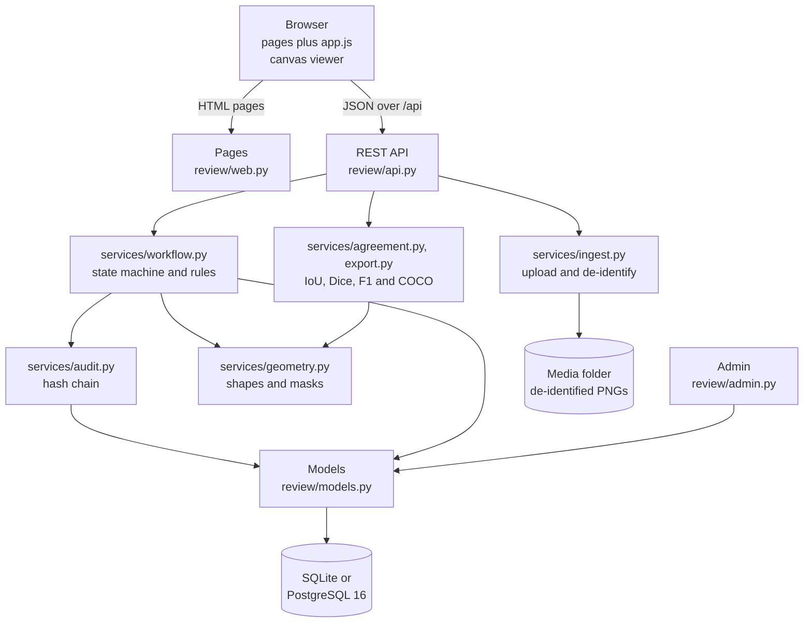

# second-read, explained

This is a plain-language guide to what second-read is, why it exists and how it is built. You do not need a background in healthcare or software to follow it. Technical terms are explained the first time they appear, and every term is in the [glossary](#glossary) at the end. For a longer explanation of the health IT standards mentioned here, see the [Health IT primer](https://github.com/Henrycarto/passayge/blob/main/docs/HEALTH_IT_PRIMER.md).

## In one sentence

second-read is a web application where people outline findings on medical images, a second person must check every outline before it counts, and every change is written to a log that shows if anyone tampers with it.

## In one paragraph

Computer programs that find tumours or other structures on medical images learn from examples: images on which a person has drawn the outline of what matters. Those outlines are only as good as the people and the process behind them. second-read is a Django web application (Django is a widely used Python framework for web servers) that runs that process. You upload an image, including the hospital image format DICOM, and the program keeps a cleaned copy with the patient's name and other identifying details removed. An annotator draws boxes and polygons on it. A reviewer, who must be a different person, approves the work or sends it back with a comment. Two annotators can outline the same image independently, without seeing each other's work, and the reviewer can measure how much they agree. Only approved outlines can be exported as a training set, and every step is written to an append-only log in which each entry is chained to the one before by a fingerprint, so a changed or deleted entry is detected. The rules are enforced on the server, not only in the screens, and 54 automated tests check them.

## The real-world problem

### A short story

Anton Gruber is 61 and had a biopsy at a hospital in Linz. (He is fictional, like everyone in this document.) The tissue was scanned, and the hospital's research group would now like to use small image tiles from many such scans to train a program that marks tumour regions. Dr. Miriam Kofler, a pathologist, and Lukas Berger, a resident, are asked to outline the tumour regions on 300 tiles.

Four questions come up:

1. **Is Anton's name still in the files?** The scanner and the archive wrote his name, patient number, birth date and the hospital's name into each image file's header. The research group must not see them.
2. **Has anyone checked Lukas's outlines?** He is still learning. If his outlines go into the training set unchecked, the program learns his mistakes.
3. **Do Miriam and Lukas actually agree?** If Lukas can see Miriam's outlines while he draws, his reading is a copy, not a second opinion.
4. **Who changed this outline, and when?** Six months later, someone asks why one tile was approved. The answer should not depend on someone's memory or on a log anyone could quietly edit.

### What goes wrong

- **Identifying data hides in headers and in pixels.** A DICOM file carries dozens of header fields, and lists of "fields to delete" tend to miss one. Some devices also write the patient's name into the picture itself, where header cleaning cannot reach it.
- **Checks that live only in the screen can be skipped.** If "a reviewer may not approve their own work" is enforced by hiding a button, anyone who calls the server directly can approve their own work.
- **Agreement is easy to measure badly.** One number for "how much do the outlines overlap" can be perfect while two readers disagree on how many lesions there are.
- **Ordinary logs can be edited.** A table of events in a database can be changed by anyone with database access, and nobody would notice.

second-read addresses each one: it keeps only a short list of technical header fields and refuses images that declare text in the pixels; every rule sits in one server-side module that every path must use; agreement is reported at two levels; and the log is hash-chained so that edits and deletions are detected.

## The healthcare background you need

Short definitions follow. The [Health IT primer](https://github.com/Henrycarto/passayge/blob/main/docs/HEALTH_IT_PRIMER.md) explains DICOM, de-identification, burned-in annotations, four-eyes review and hash-chained audit trails in more depth.

**DICOM (Digital Imaging and Communications in Medicine).** The standard file format and network protocol for medical images such as X-rays, CT, MRI and ultrasound. A DICOM file holds the pixels and a header of tagged attributes: patient name, patient ID, birth date, the institution, the device, and how the pixels should be displayed. It is like a photograph with a very detailed label stuck to the back.

**Modality.** The kind of imaging device or method, such as CT (computed tomography), MR (magnetic resonance), CR (radiography), US (ultrasound) or SM (slide microscopy, scanned tissue). second-read stores one modality per study (`review/models.py`, `Study.Modality`).

**Window centre and width.** Medical images often have thousands of grey levels (12 or 16 bits), but a screen shows 256. The window says which slice of the range to show: centre is the middle grey, width is how wide a range maps from black to white. It is like choosing the exposure when you print a photo from a negative.

**MONOCHROME1 and MONOCHROME2.** Two ways a grey-scale DICOM image can store brightness. In MONOCHROME2, higher numbers are brighter; in MONOCHROME1, higher numbers are darker, so the image must be inverted to look right. It is the difference between a photo and its negative.

**De-identification.** Removing information that could identify a person before images are shared or reused for research. In DICOM this means the header, and DICOM's Part 15 defines profiles of what to remove. Think of blacking out names on a photocopy before you hand it round.

**Burned-in annotation.** Text, such as a patient's name, written into the image pixels themselves instead of the header. Header cleaning cannot remove it. DICOM has an attribute, Burned In Annotation, that says whether an image contains such text. It is a name written in ink on the photo instead of on the back.

**Pseudonymous reference.** A code such as `DEMO-0001` that stands for a patient or case without naming them. Whoever holds the key can link it back; the system that uses it cannot. In second-read a study carries only such a reference (`subject_ref` in `review/models.py`). It is like a cloakroom ticket.

**Annotation and ground truth.** An annotation is a mark a person makes on an image, here a box or a polygon with a label such as "tumour region". A set of checked annotations is what machine-learning people call ground truth: the examples a program learns from and is tested against. It is the answer key for an exam.

**Reader, double reading and four-eyes review.** In medicine, a reader is the person who interprets an image. Double reading means two people read the same image independently; four-eyes review means one person's work counts only after a second person checks it. Independence matters: a reviewer who sees the first reading before forming a view is no longer a second opinion. It is a bank transfer that needs two signatures.

**Inter-reader agreement: IoU and Dice.** Two ways to measure how much two outlines overlap. IoU (intersection over union) is the shared area divided by the combined area; Dice is twice the shared area divided by the sum of both areas. Both range from 0 (no overlap) to 1 (identical). Two half-overlapping squares of equal size have an IoU of 1/3 and a Dice of 0.5.

**Precision, recall and F1.** Ways to count whether two readers found the same objects, not just the same pixels. Precision is the share of reader B's objects that match one of reader A's; recall is the share of reader A's objects that B found; F1 combines both into one number. It is like checking two shopping lists item by item, instead of comparing their total weight.

**Audit trail, GxP and 21 CFR Part 11.** An audit trail is a record of who did what, when, and what changed. GxP is a family of "good practice" rules in regulated health work (for example good clinical practice), and 21 CFR Part 11 is a US regulation for electronic records; both expect records to be attributable, contemporaneous and protected from silent change. second-read follows these ideas but makes no claim to meet them (`README.md`, "Known limits"). It is a sign-in sheet that cannot be torn out.

**COCO.** A widely used JSON file format for image annotations (named after the Common Objects in Context dataset). It lists images, categories and annotations with boxes, polygons and areas, and many training tools can read it.

## What it does, step by step

Here is one full journey through the demo data that `python manage.py seed_demo` creates (`review/management/commands/seed_demo.py`): three users (annotators `anna` and `ben`, reviewer `rita`), three labels (tumour region, lymphocyte cluster, artefact), and one study of three generated tissue-like tiles, 768 by 512 pixels. The seeder has already made anna and ben outline the first tile and submit their readings.

1. **Rita signs in** at `/login/`. Roles are Django groups called `annotator` and `reviewer` (`review/services/roles.py`). Every page requires a login, and every API call except the label list requires one of the two roles (the label list needs only a login).
2. **Someone uploads an image.** On a study page, the browser sends the file to `POST /api/studies/{id}/images/`. The server checks the size (50 MB by default, `SECOND_READ_MAX_UPLOAD_BYTES` in `config/settings.py`) and passes the bytes to `process_upload()` in `review/services/ingest.py`. A DICOM file is recognised by the letters `DICM` at byte 128. If it declares burned-in annotation, it is refused. Otherwise the pixels are windowed to 8 bits, inverted if MONOCHROME1, reduced to the middle frame if there are several, and saved as a PNG. Only eleven technical header fields are copied out (`KEEP_DICOM`); the original file is not stored. PNG, JPEG and TIFF are re-encoded as PNG, which drops embedded camera data (EXIF). A SHA-256 fingerprint of the uploaded bytes is stored, and the same file cannot be added to a study twice (answer `409 Conflict`). The upload is written to the audit log.
3. **Anna opens the tile to annotate it.** The page `images/{id}/annotate/` loads, and the browser script `review/static/review/app.js` calls `POST /api/images/{id}/tasks/`, which creates her own task for this image or returns the existing one. A task is one reader's work on one image, with a status: draft, submitted, approved or rejected.
4. **Anna draws.** She drags a box or clicks the corners of a polygon. Each shape goes to `POST /api/tasks/{id}/annotations/`. The server checks the shape (`validate_geometry()` in `review/services/geometry.py`): a box must have positive size and lie inside the image, a polygon needs 3 to 2,000 points inside the image and a non-zero area. Each new, changed or deleted shape writes an audit event; a change records the values before and after.
5. **Anna submits.** `POST /api/tasks/{id}/submit/`. A task with no shapes cannot be submitted. From now on the task is frozen: any further change is refused with `409`.
6. **Ben reads the same tile.** He gets his own task and cannot see anna's: asking for her task or one of her shapes returns `404 Not Found`, as if it did not exist.
7. **Rita opens the review queue** at `/review/`. It lists submitted tasks, oldest first, and leaves out her own. She opens anna's task and sees her shapes.
8. **Rita compares the two readings.** She picks ben's task and presses Compare, which calls `GET /api/images/{id}/agreement/?task_a=...&task_b=...`. Both readings must have left draft. The answer has one row per label. For the demo tile it is: tumour region IoU 0.93, Dice 0.96, one object each, matched, F1 1.0; lymphocyte cluster IoU 0.80, Dice 0.89, F1 1.0; artefact used by ben only, so IoU 0 and F1 0, counted as full disagreement. Ben's shapes are drawn as a dashed white overlay.
9. **Rita decides.** Approve, or reject with a comment (`POST /api/tasks/{id}/approve/` or `/reject/`). A rejection without a comment is refused. A rejected task becomes editable again, anna sees the comment, fixes the shape and resubmits. Rita could not decide on her own task even if she had drawn one, and neither could an administrator.
10. **Rita exports the training set.** `GET /api/studies/{id}/export/coco/` returns a COCO file with approved tasks only. Each annotation carries the task id and the annotator's user name.
11. **Anyone with the reviewer role can check the log.** `GET /api/audit/` lists the last 200 events, and `GET /api/audit/verify/` walks the whole chain and answers either "ok, N events checked" or the first broken event and whether it was modified or removed.

## How it is built

### The parts

| Part | What it is | Why it exists | Talks to |
|---|---|---|---|
| **Pages** ([review/web.py](../review/web.py), [templates](../review/templates/review)) | Server-rendered screens: study list, study with upload form, annotation viewer, review queue, review viewer, login. | So people can work without calling the API by hand. The pages only read; every change goes through the API. | The models for reading; the browser script does the writing. |
| **Browser script** ([review/static/review/app.js](../review/static/review/app.js)) | Plain JavaScript with no build step. Draws the image and shapes on a canvas, handles box and polygon drawing, submit, approve, reject and compare. | The interactive part of the viewer. | Only the REST API, with Django's CSRF token. |
| **REST API** ([review/api.py](../review/api.py), [review/serializers.py](../review/serializers.py)) | Django REST Framework view sets for studies, images, tasks, annotations, labels, audit and verify. | A machine interface, and the single place where rule violations become HTTP status codes (`run()`: 403, 409 or 400). | The service layer. |
| **Roles** ([review/services/roles.py](../review/services/roles.py)) | `is_annotator()` and `is_reviewer()`, based on Django groups. A superuser counts as both. | Administrators manage roles without code. | Used by the API, pages and workflow. |
| **Ingest** ([review/services/ingest.py](../review/services/ingest.py)) | `process_upload()`: detects DICOM, refuses burned-in annotation, windows the pixels, keeps the `KEEP_DICOM` whitelist, re-encodes everything as PNG, refuses images over 100 million pixels. | De-identification and a uniform image format. | pydicom, NumPy and Pillow. |
| **Workflow** ([review/services/workflow.py](../review/services/workflow.py)) | `start_task()`, `add_annotation()`, `update_annotation()`, `delete_annotation()`, `submit()`, `decide()`, and `WorkflowError`. | Every state change and permission check in one place, each in a database transaction with its audit event. | Geometry, audit and the models. |
| **Audit** ([review/services/audit.py](../review/services/audit.py), `AuditEvent` in [review/models.py](../review/models.py)) | `record()` appends one event with the previous event's hash; `verify_chain()` checks the whole chain. The model refuses updates and deletes. | A log that shows tampering. | The database. |
| **Geometry** ([review/services/geometry.py](../review/services/geometry.py)) | `validate_geometry()`, `polygon_area()` (shoelace formula), `bbox()`, `as_polygon()`, `rasterise()` (shapes to a pixel mask). | One definition of what a valid shape is and how it covers pixels. | Pillow and NumPy. |
| **Agreement** ([review/services/agreement.py](../review/services/agreement.py)) | `compare()`, `mask_iou()`, `mask_dice()`, `match_instances()`. | Inter-reader agreement at pixel and object level. | Geometry. |
| **Export** ([review/services/export.py](../review/services/export.py)) | `coco_for_study()`: approved tasks only, with task id and annotator on each annotation. | Hands a training set to other tools, with its origin. | Models and geometry. |
| **Admin** ([review/admin.py](../review/admin.py)) | Django's admin site. Tasks and reviews are shown read-only; audit events cannot be added, changed or deleted there. | User, group and label management. | The models. |
| **Demo seeder** ([review/management/commands/seed_demo.py](../review/management/commands/seed_demo.py)) | Creates users, labels, a study of three generated tiles, and two submitted readings, using the same ingest and workflow functions. Running it twice changes nothing. | Something to look at straight away, with no real data. | Ingest and workflow. |
| **Settings and deployment** ([config/settings.py](../config/settings.py), [Dockerfile](../Dockerfile), [docker-compose.yml](../docker-compose.yml)) | SQLite by default; PostgreSQL when `POSTGRES_DB` is set. The container runs gunicorn on Python 3.12; Compose adds PostgreSQL 16 and runs the seeder. | Zero setup locally, a real database in Docker and CI. | Environment variables. |

## The technology stack

Versions are the ranges in `requirements*.txt`, with the version installed in my test run in brackets.

| Item | Version | What it does here | Why this one |
|---|---|---|---|
| Python | 3.12 (`Dockerfile`, CI, `ruff.toml`) | The language for the whole server. | Not recorded in the repo: not confirmed. A reasonable reading: pydicom, NumPy and Pillow make Python the natural choice for image handling. |
| Django | >=5.1,<5.2 (5.1.15) | Web framework: models, database migrations, pages, login, admin. | Not confirmed. A reasonable reading: the built-in admin, groups and transactions are used directly (roles as groups, read-only admin). |
| Django REST Framework | >=3.15,<3.18 (3.17.2) | The REST API, session and token login, pagination. | Not confirmed. It plugs into Django's users and sessions, so the browser and scripts share one API. |
| pydicom | >=3.0,<4 (3.0.2) | Reads DICOM files and their pixel data. | Not confirmed. A reasonable reading: it is the standard pure-Python DICOM library. |
| Pillow | >=10.4 (13.0.0) | Reads PNG, JPEG and TIFF, writes PNG, draws shapes into masks. | Not confirmed. |
| NumPy | >=1.26 (2.5.4) | Pixel arithmetic for windowing and the masks for IoU and Dice. | Not confirmed. |
| SQLite | bundled with Python | Default database for local use and tests. | No setup needed (default in `config/settings.py`). |
| PostgreSQL | 16 (`docker-compose.yml`, CI), driver psycopg >=3.2 | Database in Docker and in one CI job. | Not confirmed why PostgreSQL over another server. CI runs every test on both databases. |
| gunicorn | >=22 (26.2.0) | Serves the app in the container, three workers. | Not confirmed. |
| Plain JavaScript and canvas | no version, no build | The viewer and drawing tools. | README: "no build step". Why not a framework is not confirmed. |
| pytest, pytest-django | >=8 (9.1.1), >=4.9 (4.14.0) | Test runner with Django database support. | Not confirmed. |
| ruff | >=0.6 (0.17.2) | Code style and lint checks, run in CI. | Not confirmed. |
| Docker, Docker Compose | not pinned | One command for app plus PostgreSQL. | Not confirmed. |
| GitHub Actions | `actions/checkout@v4`, `actions/setup-python@v5` | CI on every push to main and every pull request. | Not confirmed. |

## The hard parts and how they were solved

### 1. Getting rid of identifying data without missing any

**Problem.** A DICOM header can hold the patient's name, ID, birth date, the institution and much more, in standard and in private, manufacturer-specific fields. A list of fields to delete has to be complete, and it rarely is. Text burned into the pixels is out of reach of any header filter. Ordinary photos and scans also carry hidden metadata (EXIF), such as the author.

**Solution.** The opposite approach: a whitelist. Only eleven technical attributes are copied out of the header: Modality, BodyPartExamined, PhotometricInterpretation, Rows, Columns, BitsStored, PixelSpacing, SliceThickness, WindowCenter, WindowWidth and Manufacturer (`KEEP_DICOM`). The original bytes are never saved; only a newly encoded PNG is. Anything that is not on the list is gone, including fields nobody thought of. A DICOM file whose Burned In Annotation attribute is `YES` is refused with a message to clean the pixels first. Every non-DICOM image is re-encoded as PNG, which leaves EXIF behind. Studies carry only a pseudonymous reference, and the model comment says names and birth dates never enter the system.

**Where.** `process_upload()`, `_read_dicom()` and `_whitelisted_metadata()` in [review/services/ingest.py](../review/services/ingest.py). Tests in [review/tests/test_ingest.py](../review/tests/test_ingest.py): "dicom keeps only whitelisted attributes" builds a DICOM file with the fictional patient name `Huber^Margarete`, ID, birth date and hospital name and checks that none of them appears in the stored metadata or the PNG; "burned in annotation is refused"; "jpeg exif is dropped"; and over the API in [review/tests/test_api.py](../review/tests/test_api.py).

### 2. Turning a medical image into something a browser can show

**Problem.** DICOM pixels can be 12 or 16 bits, scaled by a slope and an intercept, displayed through a window, stored "negative" (MONOCHROME1), or stacked into many frames. A browser shows 8-bit images.

**Solution.** `_window_to_uint8()` applies the rescale slope and intercept, then the first window centre and width from the header if present, or else the image's own minimum and maximum, clips to 0 to 255, and inverts MONOCHROME1. RGB images are passed through. For multi-frame files the middle frame is kept as the representative image. Compressed DICOM that pydicom cannot decode is refused with a clear error. Images over 100 million pixels are refused before decoding, to stop "decompression bombs" (small files that expand to huge images).

**Where.** `_read_dicom()`, `_window_to_uint8()`, `_first()` and `MAX_PIXELS` in [review/services/ingest.py](../review/services/ingest.py). Tests: "dicom is windowed to full 8bit range", "monochrome1 is inverted", "multiframe takes one frame".

### 3. Four eyes and blind readings, enforced on the server

**Problem.** Nobody may approve their own work, including administrators. Submitted work must not change while it is being reviewed. A reader must not see another reader's work, or the second reading is not independent. And all of this must hold however the server is reached: browser, API script or admin.

**Solution.** All state changes go through [review/services/workflow.py](../review/services/workflow.py). Each one runs in a database transaction, and every change to a task's shapes or status first locks the task row (`select_for_update()`), so two requests cannot change the same task at once. After locking the task, `decide()` refuses a reviewer who is the task's annotator, with no exception for superusers (the code comment says "superuser or not"). Only draft and rejected tasks are editable; submitted, approved and rejected follow fixed transitions, and a rejection needs a comment. The admin shows tasks and reviews read-only. Blinding is done in the queries: `visible_tasks()` in [review/api.py](../review/api.py) returns only the user's own tasks unless they are a reviewer, so another reader's task or shape answers `404`, not `403`, and its existence is not revealed. The agreement endpoint refuses to compare drafts. A database constraint allows one task per reader per image.

**Where.** `decide()`, `submit()`, `_require_owner_and_editable()` in `workflow.py`; `visible_tasks()` and `run()` in `api.py`; `one_task_per_reader_per_image` in [review/models.py](../review/models.py). Tests: "superuser is still bound by four eyes", "submitted task is frozen", "reject needs comment then reader can fix and resubmit", "cannot decide twice" in [review/tests/test_workflow.py](../review/tests/test_workflow.py); "readers are blinded to each other" and "review flow status codes" in [review/tests/test_api.py](../review/tests/test_api.py).

### 4. A log that shows if someone changes it

**Problem.** The audit log must always match the data, and someone who edits the database directly should not be able to change or remove an entry unnoticed.

**Solution.** Each `AuditEvent` stores who acted, the action, the object, a JSON payload, the time, the previous event's hash and its own hash. The hash is SHA-256 over a canonical JSON form of all of that (keys sorted, no spaces), so any change to the content changes the hash, and because it includes the previous hash, the events form a chain from a "genesis" value of 64 zeros. `verify_chain()` walks the chain in order and reports the first event whose stored previous hash does not match (an event was removed or reordered) or whose content does not match its own hash (an event was modified). In the application, the model refuses `save()` on an existing event and `delete()`, and so does its query set for bulk `update()` and `delete()`; the admin refuses add, change and delete. `record()` is called inside the same transaction as the change it describes, so a failed change leaves no event and an event never describes a change that did not happen. It locks the latest event while it appends.

**Where.** `AuditEvent`, `AuditEventQuerySet`, `canonical()`, `compute_hash()` in [review/models.py](../review/models.py); `record()`, `verify_chain()`, `GENESIS` in [review/services/audit.py](../review/services/audit.py); `AuditVerifyView` in `api.py`. Tests in [review/tests/test_audit.py](../review/tests/test_audit.py): "orm refuses changes", "raw sql edit is detected" (reported as modified at that event), "raw sql delete is detected" (reported as removed at the next event); and "invalid geometry never reaches the database", which checks that no audit event is left behind.

### 5. Agreement that does not hide disagreement

**Problem.** If reader A outlines one large region and reader B splits the same area into three lesions, their pixels overlap perfectly. A single overlap number says they agree; clinically they do not.

**Solution.** `compare()` reports per label at two levels. Pixel level: all of a reader's shapes for the label are turned into one pixel mask, and IoU and Dice are computed between the two masks. Object level: each shape becomes its own mask, pairs with IoU at or above a threshold (0.5 by default, adjustable from 0 exclusive to 1) are matched one-to-one, best pairs first, and precision, recall and F1 are computed with reader A as the reference. A label only one reader used counts as total disagreement (F1 = 0), not as missing data. If neither reader marked any pixels, IoU and Dice are "undefined" rather than a misleading 1.0. Matching is greedy instead of the optimal Hungarian algorithm; the code comment says this avoids an extra dependency and agrees in practice when there are few objects per label.

**Where.** [review/services/agreement.py](../review/services/agreement.py), `rasterise()` in [review/services/geometry.py](../review/services/geometry.py). Tests in [review/tests/test_agreement.py](../review/tests/test_agreement.py): "half overlap has known iou and dice" (1/3 and 0.5), "pixel overlap can hide a count disagreement" (IoU 1.0, F1 0.0), "matching is one to one", "label used by only one reader is total disagreement".

## How we know it works

Counts below are from my own run on 24 October 2026 on Windows, Python 3.12.7, Django 5.1.15 and SQLite, in a fresh virtual environment with `requirements-dev.txt`, using `pytest` from the repository root. All 54 tests passed, none failed, none were skipped (32.6 seconds).

| Suite (file) | Tests | What it proves |
|---|---|---|
| Workflow ([test_workflow.py](../review/tests/test_workflow.py)) | 12 | The happy path with its exact audit trail (task created, annotation created, task submitted, task approved); four eyes, including superusers; annotators cannot decide; empty tasks cannot be submitted; submitted tasks are frozen; another annotator cannot edit; reject, fix and resubmit; no second decision; before and after values in update events; invalid shapes never reach the database; starting a task twice returns the same task. |
| API ([test_api.py](../review/tests/test_api.py)) | 11 | Login and a role are required; upload of PNG and DICOM, with no patient name in the metadata, and duplicates refused with 409; garbage upload is 400; readers are blinded (404); status codes for each rule; bad geometry and unknown label are 400; the agreement endpoint returns the expected IoU and is reviewer-only; drafts are not compared; the COCO export contains only approved work; audit endpoints are reviewer-only and the chain verifies; API route names do not clash with page names. |
| Geometry ([test_geometry.py](../review/tests/test_geometry.py)) | 11 | Valid box and polygon; eight invalid cases (zero size, outside, wrong shape of data, `True` used as a number, too few points, zero area, unknown shape); area and bounding box; a rasterised box covers exactly its pixels. |
| Ingest ([test_ingest.py](../review/tests/test_ingest.py)) | 8 | Whitelist only, with name, ID, birth date and institution absent; windowing to the full 8-bit range; MONOCHROME1 inversion; multi-frame; burned-in annotation refused; PNG re-encoded; JPEG EXIF dropped; garbage refused. |
| Agreement ([test_agreement.py](../review/tests/test_agreement.py)) | 5 | Identical readings score 1.0; known IoU and Dice for half overlap; one-reader labels count as disagreement; count disagreement hidden by pixel overlap is caught; one-to-one matching. |
| Audit ([test_audit.py](../review/tests/test_audit.py)) | 4 | The chain verifies and links; the ORM refuses changes; raw SQL edits and deletions are detected at the right event. |
| Pages ([test_pages.py](../review/tests/test_pages.py)) | 3 | The demo seeder is idempotent and its audit chain verifies; every screen renders for the right role and refuses the wrong one; anonymous users are sent to login. |

That is 54 tests in total, matching the number in the README.

In the same run, `ruff check .` reported "All checks passed!" and `python manage.py makemigrations --check --dry-run` reported "No changes detected" (the database schema and the models agree).

I also ran the demo seeder against a throwaway SQLite database outside the repository: it created 9 audit events, `verify_chain()` reported 9 checked and ok, and the agreement numbers for the first tile were the ones quoted in step 8 above.

**Continuous integration** ([.github/workflows/ci.yml](../.github/workflows/ci.yml)) runs one job, `test`, twice, as a matrix over the database: `test (sqlite)` and `test (postgres)`, the latter against a PostgreSQL 16 service container. Each installs the dependencies, runs `ruff check .`, the missing-migrations check and `pytest`. The latest run (`gh run list`), on commit `021cac8` of 21 October 2026, succeeded: `test (postgres)` in 44 s and `test (sqlite)` in 47 s. GitHub reported only notices that the Node.js 20 actions are deprecated.

**Official validation.** There is none to report. The DICOM handling is tested with files the tests build themselves using pydicom, not with real device output or a DICOM conformance tool. The COCO output is checked by the tests for its fields and values, not against a published schema or a COCO library. Whether the whitelist meets a DICOM PS3.15 confidentiality profile has not been checked: not confirmed. The Docker Compose stack was not started for this write-up.

## What is deliberately simplified or left out

| Simplification | Why |
|---|---|
| Whole-slide pathology images (gigapixel scans) are not supported; images and tiles up to 100 million pixels are. | README: they need a tiled viewer (OpenSeadragon is named) and tiled storage. |
| One frame per DICOM file: multi-frame files are reduced to the middle frame. | README: a real radiology tool would let the reader scroll the series. |
| Compressed DICOM (JPEG 2000, JPEG-LS) is refused. | It needs extra decoders such as `pylibjpeg`, which are not installed. |
| The audit chain is tamper-evident, not tamper-proof. | README: someone with database access can rewrite the whole chain consistently. Anchoring the latest hash outside the database would close the gap; not built. |
| No regulatory claim. | README: the ideas follow GxP and 21 CFR Part 11, but it is a portfolio project, not a validated system. |
| Two shapes only: box and polygon. No brush, no freehand masks, no measurements. | Not recorded in the repo: not confirmed. |
| Only two roles, as Django groups; no projects, no assignment of images to particular readers. | Not recorded: not confirmed. Any annotator can open any image. |
| All images and demo data are generated. | README: there is no patient data in this repository. |

Also worth knowing:

- The burned-in check trusts the file. An image whose Burned In Annotation attribute is missing or `NO` is accepted, even if it does contain text in the pixels, and PNG, JPEG and TIFF uploads have no such check. Nothing looks at the pixels for text.
- The uploaded file name is stored as `original_name` and returned by the API. If a file name contained a patient's name, it would be kept.
- Media files (the PNGs) are only served by Django when `DEBUG` is on (`config/urls.py`), and Docker Compose turns it on. How images would be served with `DEBUG` off is not set up in the repo: not confirmed. When Django serves them, the media URLs do not check login or role.
- The demo seeder creates the study and its images directly, so the demo log has no `study.created` or `image.uploaded` events; the readings and submissions do go through the workflow and are logged.
- The admin can still edit studies, images and labels, and delete tasks and reviews, without an audit event. Only tasks and reviews are shown read-only, and only audit events are fully locked.
- `verify_chain()` checks the chain from the start. If the most recent events were deleted, the shorter chain would still verify, because nothing records how long the chain should be. This is part of the "tamper-evident, not tamper-proof" limit.
- The lock in `record()` is on the latest existing event. Whether two simultaneous writers on PostgreSQL can both read the same previous hash, which would fork the chain, is not tested: not confirmed. On SQLite, row locks are not used and writes are serialised by the database file lock.
- The study list and study pages need only a login, not a role, so a signed-in user without a group can see study titles and images (`review/web.py`). The API refuses such a user.
- The COCO export records the task id and annotator on each annotation, but not the reviewer; the reviewer is found through the task's review record.

## Glossary

**21 CFR Part 11.** A US regulation on electronic records and signatures in regulated health work. second-read follows some of its ideas without claiming to meet it.

**Annotation.** A mark on an image made by a person, here a box or polygon with a label.

**Annotator.** In second-read, a user in the `annotator` group, who draws readings.

**API (application programming interface).** A way for programs to talk to the server. Here a REST API under `/api/`.

**Append-only.** A store where entries can be added but never changed or removed.

**Audit event, audit trail.** One entry, and the whole record, of who did what, when, and what changed.

**Bounding box.** A rectangle given as x, y, width and height, in image pixels, origin top left.

**Burned-in annotation.** Text written into the image pixels, such as a patient name. DICOM attribute Burned In Annotation says whether it is present.

**Canonical JSON.** A fixed way of writing JSON (sorted keys, no spaces) so that the same content always produces the same text and the same hash.

**CI (continuous integration).** Automated checks that run on every change, here on GitHub Actions.

**COCO.** A JSON format for image annotations with images, categories, boxes, polygons and areas.

**CSRF token.** A secret value a web page sends back with each change, so other websites cannot make changes on a signed-in user's behalf.

**De-identification.** Removing information that could identify a person before data is reused.

**Dice coefficient.** Twice the shared area divided by the sum of both areas; 0 to 1.

**DICOM.** The standard format and protocol for medical images.

**Django.** A Python web framework with models, migrations, pages, login and an admin site.

**Django REST Framework (DRF).** A library for building REST APIs on Django.

**Double reading.** Two readers interpret the same image independently.

**EXIF.** Metadata stored inside photo files, such as camera, date or author.

**F1 score.** A single number combining precision and recall; 0 to 1.

**Four-eyes principle.** Work counts only after a second, different person has checked it.

**Genesis hash.** The starting value of the chain, 64 zeros, used as the "previous hash" of the first event.

**Ground truth.** Checked annotations used to train and test a program.

**GxP.** The family of "good practice" rules in regulated health work, such as good clinical practice.

**H&E.** A common tissue stain (haematoxylin and eosin) that colours tissue pink and purple; the demo tiles imitate its look.

**Hash, SHA-256.** A fingerprint of data: any change to the data gives a completely different value. SHA-256 produces 64 hexadecimal characters.

**Hash chain.** A sequence of entries where each includes the hash of the one before, so changing one breaks all after it.

**Hungarian algorithm.** A method that finds the best possible one-to-one matching; second-read uses a simpler greedy matching.

**Idempotent.** Doing it twice has the same effect as doing it once, like the demo seeder.

**Inter-reader agreement.** How much two readers' annotations of the same image agree.

**IoU (intersection over union).** Shared area divided by combined area; 0 to 1.

**JSON.** A simple text format for structured data.

**Label.** The name of what an annotation marks, such as "tumour region", with a display colour.

**Mask.** A grid of yes/no values, one per pixel, saying which pixels a shape covers.

**Migration.** A Django file that describes a change to the database tables.

**Modality.** The kind of imaging, such as CT, MR, CR, US or SM.

**MONOCHROME1, MONOCHROME2.** DICOM grey-scale encodings: in MONOCHROME1 high values are dark, in MONOCHROME2 high values are bright.

**Multi-frame.** A DICOM file holding several images, such as the slices of a series.

**ORM (object-relational mapper).** The part of Django that turns database rows into Python objects and back.

**PACS (picture archiving and communication system).** A hospital's image archive, speaking DICOM.

**Pixel spacing.** The real size of one pixel, in millimetres, from the DICOM header.

**Polygon.** A closed shape given by a list of corner points.

**Precision.** The share of reader B's objects that match one of reader A's.

**Pseudonymous reference.** A code that stands for a patient or case without naming them.

**Reader.** A person who interprets an image; in second-read, the annotator of a task.

**Recall.** The share of reader A's objects that reader B also found.

**REST.** A style of web interface that reads and writes data with standard web requests (GET, POST, PATCH, DELETE).

**Review.** In second-read, one decision (approve or reject, with an optional comment) on one task.

**Reviewer.** A user in the `reviewer` group, who decides on other people's tasks.

**Row lock.** A database lock on one row, so other transactions wait until the first is finished.

**Service layer.** The modules in `review/services/` that hold all rules, so every entry point behaves the same.

**State machine.** A fixed set of states and allowed moves between them: here draft, submitted, approved and rejected.

**Study.** A group of images about one pseudonymous subject or case, with one modality.

**Task.** One reader's work on one image, with its status and shapes.

**Tamper-evident.** Changes can be detected, though not prevented.

**Transaction.** A group of database changes that either all happen or none do.

**Whitelist.** A list of what is allowed; everything else is dropped.

**Whole-slide image.** A gigapixel scan of a complete pathology slide. Not supported here.

**Window centre and width.** Which part of the grey-value range is shown on screen, and how wide it is.
